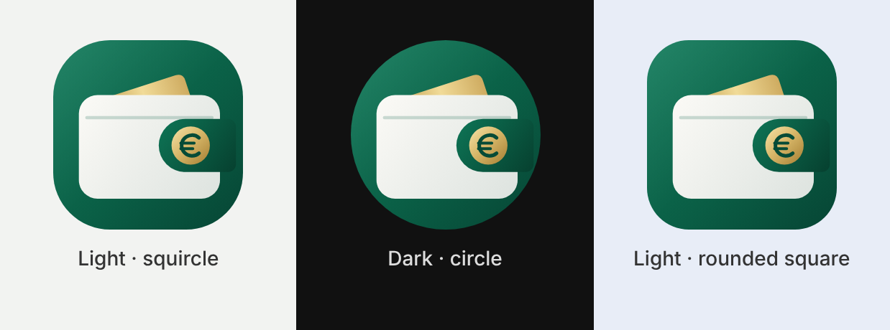

# Moneta: personal finance tracker

Moneta is a native Android app (Kotlin, Jetpack Compose, Material 3, Room) for tracking
personal income and expenses. Its layout is tuned for large Samsung Galaxy phones such as the
Galaxy S26 Ultra. It runs fully offline. The app has **no internet permission**, so financial
data cannot leave the phone unless you export or back it up yourself.



## Features

| Area | What it does |
|---|---|
| **Home** | Total balance (opening balance + income − expenses), all-time income, expenses and net position, this month's income, expenses, remaining money and % of income spent, a 6-month income-vs-expenses chart, and recent transactions |
| **Add / edit** | One screen for income and expenses: amount, category, date (Today / Yesterday / any date), payment method, description, notes, and an optional repeat |
| **Transactions** | Chronological history with search (text and amount), filters (type, date range, category, payment method), daily, weekly and monthly summaries, and edit or delete with confirmation (long-press a row, or the delete button in the editor) |
| **Statistics** | Spending today, this week, this month and this year. For any month or year you pick: income, expenses, balance, savings rate, average daily spending, daily or monthly bar charts, weekly breakdown, category donut with most expensive categories, and the balance trend through the year |
| **Budgets** | Monthly spending limit, per-category budgets, a monthly savings goal, and notifications at 80 % and when a budget is exceeded (once per level per month) |
| **Recurring** | Daily, weekly, monthly or yearly income and expenses (salary, rent, utilities, subscriptions, instalments) |
| **Categories** | Default income and expense categories, plus custom ones with your own icon and colour. Deleting a category moves its transactions to "Other" |
| **Data** | Room/SQLite storage, CSV and PDF export, and JSON backup and restore through the system file picker |
| **Security** | Optional PIN (stored as a salted PBKDF2 hash) with biometric unlock. The app re-locks after 30 s in the background |
| **Design** | Light and dark themes, edge-to-edge layout, large collapsing headers in the style of One UI, an adaptive launcher icon with a themed (monochrome) layer |

## How the numbers stay accurate

* **Integer cents only.** Every amount is a `Long` count of minor units. Floating point is never
  used for money. Sums use `Math.addExact`, so an overflow raises an error instead of wrapping.
* **No silent rounding.** Input with more than 2 decimal places is rejected, not rounded.
  Currency formatting uses `RoundingMode.UNNECESSARY`.
* **Formulas**
  * Total balance = opening balance + total income − total expenses
  * Monthly balance = monthly income − monthly expenses
* **Each transaction is counted once.** All screens compute their figures from the same
  transaction list, which Room re-emits after every insert, edit or delete, so every screen
  updates immediately.
* **Dates are calendar dates** (stored as epoch days with no time or time zone), so a transaction
  never moves to another day or month when the time zone changes.
* **Recurring transactions cannot duplicate.** Each generated entry stores
  `(recurringRuleId, occurrenceIndex)` under a UNIQUE index, and generation runs inside a database
  transaction. Occurrence *n* is computed as start + *n* periods, so a rule that starts on the 31st
  falls on the 28th/30th in shorter months and returns to the 31st afterwards. Due entries are
  recorded when the app opens and by a background job twice a day. After a rule has recorded
  entries, its schedule can no longer be changed.
* **Currency.** EUR (€) is the default. Changing the currency in Settings changes only how amounts
  are displayed. Only currencies with 2 decimal places are offered, which matches how amounts are
  stored.

## Project structure

```
app/src/main/java/com/moneta/finance/
├── domain/        Pure Kotlin: Money (parse/format), FinanceCalculator, Recurrence,
│                  TransactionFilter/Grouping, CsvWriter. Unit tested.
├── data/          Room entities and DAOs, FinanceRepository, BackupCodec (JSON),
│                  ReportExporter (CSV/PDF), BudgetAlertService, RecurringWorker
├── security/      AppLockManager (PIN hash, biometric flag, re-lock timer)
├── ui/            Compose screens: home, transactions, edit, stats, budgets, settings,
│                  categories, recurring, lock; theme and shared components/charts
├── AppContainer.kt, MonetaApplication.kt, MainActivity.kt
app/src/main/res/  Adaptive icon (background, foreground and monochrome vector layers), themes
app/src/test/      JVM unit tests: money, calculations, recurrence, filters, CSV, backup
app/src/androidTest/ Room integration tests (add/edit/delete totals, recurring de-duplication,
                     category deletion, backup/restore)
```

Toolchain: AGP 8.10.1, Gradle 8.14.3, Kotlin 2.1.21, Compose BOM 2025.05.00, Room 2.7.1,
compileSdk/targetSdk 36 (Android 16), minSdk 26 (Android 8.0).

## Build the debug APK

### Option A: GitHub Actions (no local setup)

Each push runs `.github/workflows/android.yml`. The workflow runs the unit tests, builds
`app-debug.apk` and uploads it as the **moneta-debug-apk** artifact. To get the APK, open the
repository's **Actions** tab, select the latest run and download the artifact.

### Option B: Android Studio

1. Install Android Studio (Narwhal or newer) with Android SDK Platform 36.
2. **File › Open** the project folder and let Gradle sync.
3. **Build › Build App Bundle(s) / APK(s) › Build APK(s)**.

### Option C: command line

Requires JDK 17+ and an Android SDK with platform 36 (set `ANDROID_HOME`, or create
`local.properties` with `sdk.dir=/path/to/Android/sdk`).

```bash
./gradlew testDebugUnitTest      # run the calculation tests
./gradlew assembleDebug          # build the APK
# output: app/build/outputs/apk/debug/app-debug.apk
./gradlew connectedDebugAndroidTest   # optional: Room tests on a connected phone or emulator
```

## Install on a Samsung Galaxy S26 Ultra

**With USB (adb):**
1. On the phone, open **Settings › About phone › Software information** and tap **Build number**
   seven times to enable Developer options.
2. Open **Settings › Developer options** and turn on **USB debugging**.
3. Connect the phone and accept the prompt on the phone, then run:
   ```bash
   adb install -r app/build/outputs/apk/debug/app-debug.apk
   ```

**Without a computer:** copy `app-debug.apk` to the phone (for example to Downloads), open it in
**My Files** and tap **Install**. When asked, allow *Install unknown apps* for My Files. If Samsung
**Auto Blocker** is turned on (Settings › Security and privacy), turn it off temporarily, because it
blocks sideloaded apps.

The debug build installs as **Moneta** with the application id `com.moneta.finance.debug`, so it
can sit next to a future release build.

## Privacy

* No `INTERNET` permission, no analytics and no ads.
* Android cloud backup and device-to-device transfer are disabled for Moneta's data
  (`allowBackup=false` plus `data_extraction_rules.xml`). Backups exist only as files you create.
* The PIN is never stored. The app keeps only a salted PBKDF2-SHA256 hash (120,000 iterations).
  After 5 wrong attempts, entry is locked for 30 seconds.
